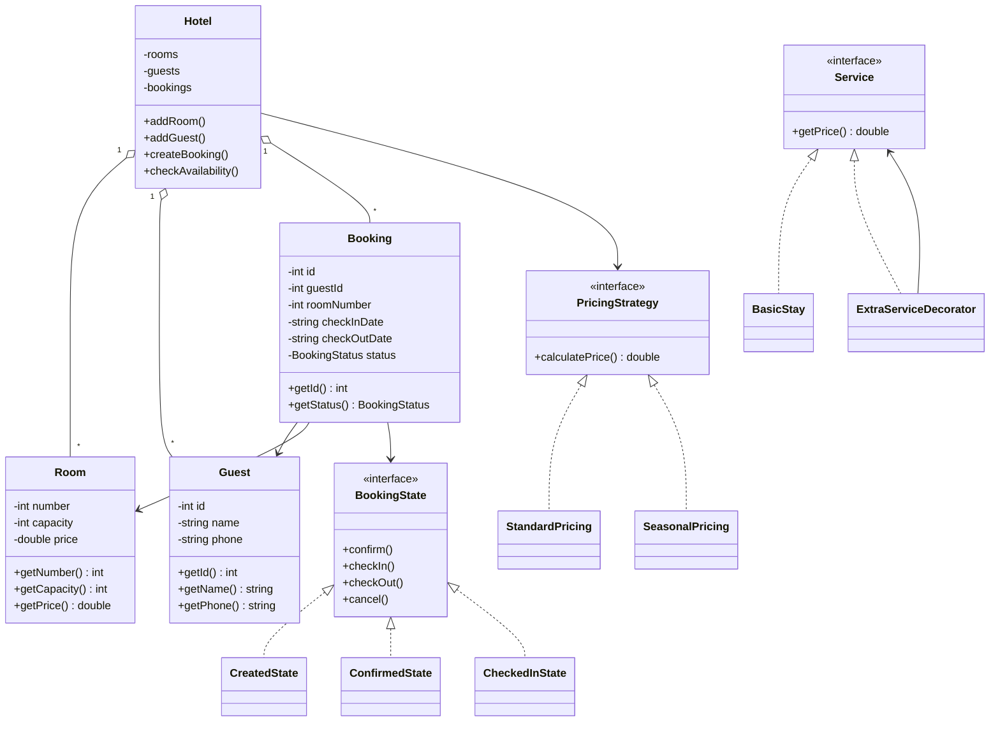

# Діаграма класів Hotel Management System

На діаграмі показані основні класи системи управління готелем та заплановане використання патернів проєктування.

## Пояснення

Room зберігає інформацію про номер готелю.

Guest зберігає інформацію про гостя.

Booking містить інформацію про бронювання, дати та його стан.

Hotel відповідає за управління номерами, гостями та бронюваннями.

State планується для керування станами бронювання.

Strategy планується для розрахунку вартості проживання за різними тарифами.

Decorator планується для додавання додаткових послуг до вартості проживання.
